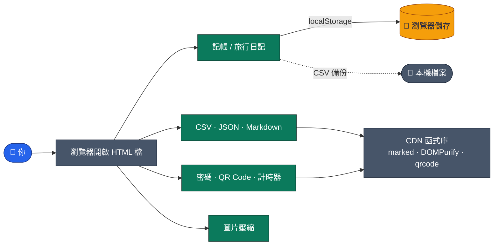

<a id="top"></a>

<div align="center">


<br>

[](https://github.com/Jiachang1112/tool)
[](https://github.com/Jiachang1112)

[](https://developer.mozilla.org/docs/Web/HTML)
[](https://developer.mozilla.org/docs/Web/CSS)
[](https://developer.mozilla.org/docs/Web/JavaScript)
[](https://getbootstrap.com/)
[](https://pages.github.com/)

**10 個純前端小工具 ‧ 記帳、CSV/JSON、密碼產生、圖片壓縮、QR Code、計時器 ‧ 一個工具一個檔案**

<br>

[](#-工具一覽)
[](#-快速開始)
[](#-資料與隱私)
[](#-注意事項)
[](#-常見問題)

</div>

---

這個倉庫收錄一批**單檔、免安裝**的網頁小工具：打開就能用，資料處理都在你的瀏覽器裡完成，不需要後端。

## 🧰 工具一覽

| 工具 | 說明 | 連結 |
| --- | --- | --- |
| 💰 進階記帳 | 新增收支、分類統計，CSV 匯出／匯入備份，資料存在瀏覽器。 | [開啟](https://jiachang1112.github.io/tool/bookkeeping.html) |
| 🔁 CSV ⇄ JSON ⇄ 表格 | 三種格式互轉，支援深色／淺色主題。 | [開啟](https://jiachang1112.github.io/tool/csv-json.html) |
| 🔑 密碼／UUID 產生器 | 一鍵產生隨機密碼與 UUID。 | [開啟](https://jiachang1112.github.io/tool/idgen.html) |
| 🖼️ 圖片縮放／壓縮 | 在瀏覽器內縮放並壓縮圖片，檔案不會上傳。 | [開啟](https://jiachang1112.github.io/tool/image-tool.html) |
| 🧾 JSON 工具 | JSON 格式化、壓縮與檢查。 | [開啟](https://jiachang1112.github.io/tool/json-tool.html) |
| 📝 Markdown 預覽器 | 即時預覽 Markdown，輸出經過 DOMPurify 淨化。 | [開啟](https://jiachang1112.github.io/tool/markdown.html) |
| 🔳 QR Code 產生器 | 輸入文字或網址就產生 QR Code 並可下載。 | [開啟](https://jiachang1112.github.io/tool/qr.html) |
| ⏱️ 碼錶／倒數／番茄鐘 | 三合一計時工具。 | [開啟](https://jiachang1112.github.io/tool/timer.html) |
| ✈️ 我的旅行日記 | 記錄旅行行程與心得，附資料備份與匯入。 | [開啟](https://jiachang1112.github.io/tool/travel_journal.html) |
| 🎨 StickerGen AI | LINE 貼圖生成介面（React 原始碼，需 Gemini API，見下方說明）。 | [開啟](https://jiachang1112.github.io/tool/line.html) |

> 🔗 連結為 GitHub Pages 網址 `https://jiachang1112.github.io/tool/`；需要在倉庫的 **Settings → Pages** 啟用後才能開啟。

---

## 🧩 運作方式



### 📁 檔案說明

```text
tool/
├── bookkeeping.html     進階記帳
├── csv-json.html        CSV / JSON / 表格 互轉
├── idgen.html           密碼 / UUID 產生器
├── image-tool.html      圖片縮放與壓縮
├── json-tool.html       JSON 工具
├── markdown.html        Markdown 預覽器
├── qr.html              QR Code 產生器
├── timer.html           碼錶 / 倒數 / 番茄鐘
├── travel_journal.html  我的旅行日記
└── line.html            StickerGen AI（React 原始碼）
```

---

## ⚡ 快速開始

**線上使用：** 直接點上面表格的「開啟」。

**本機使用：**

```bash
git clone https://github.com/Jiachang1112/tool.git
cd tool
# 直接用瀏覽器開啟任何一個 .html 檔即可
python3 -m http.server 8000     # 或啟動簡單伺服器：http://localhost:8000/qr.html
```

---

## 🔒 資料與隱私

- 記帳與旅行日記的資料存在**這台瀏覽器的 localStorage**，不會上傳到任何伺服器。
- 因此**清除瀏覽器資料、換瀏覽器或換裝置就看不到**舊資料，請定期用工具內的「CSV 備份」匯出。
- 圖片、JSON、CSV 的處理都在本機完成；部分工具會從 CDN 載入函式庫（如 marked、DOMPurify、qrcode、Bootstrap Icons），需要網路。

---

## ⚠️ 注意事項

- `line.html`（StickerGen AI）其實是 **React 元件原始碼**，裡面的 `apiKey` 是空字串，原本設計是由平台注入 Gemini API 金鑰；直接用瀏覽器開啟**不會正常運作**，需要放進 Vite／Next.js 等 React 專案並自行處理 API 金鑰（金鑰不要寫進前端程式碼）。
- 記帳的資料只存在瀏覽器，重要紀錄請定期備份。

---

## ❓ 常見問題

<details>
<summary><b>為什麼點連結是 404</b></summary>

請到倉庫的 **Settings → Pages** 啟用 GitHub Pages（Deploy from a branch → main / root）。

</details>

<details>
<summary><b>記帳資料不見了</b></summary>

資料存在瀏覽器的 localStorage，清除網站資料就會消失；請定期匯出 CSV 備份，之後可再匯入。

</details>

<details>
<summary><b>工具需要網路嗎</b></summary>

大部分功能在本機運作，但部分頁面會從 CDN 載入函式庫，所以第一次開啟需要連網。

</details>

---

<div align="center">

[GitHub @Jiachang1112](https://github.com/Jiachang1112)　‧　[tool](https://github.com/Jiachang1112/tool)

[](#top)

</div>
